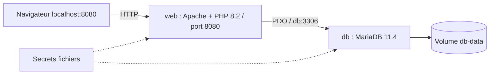

# Projet Docker Ynov — Application Articles

J'ai conteneurisé l'application PHP fournie en séparant le service Web de la base MariaDB. J'ai ajouté la persistance, les secrets, les contrôles de santé, les protections applicatives et un pipeline GitHub Actions.

## Lancement

J'utilise des conteneurs Linux avec Docker Compose v2+ et Python 3 pour initialiser les secrets et lancer les tests. Le premier build nécessite une connexion Internet.

```powershell
python scripts/setup.py
docker compose up -d --build --wait
```

L'application est accessible sur **http://localhost:8080**.

J'ai également publié les images sur Docker Hub. Pour les utiliser sans compiler :

```powershell
python scripts/setup.py
docker compose pull
docker compose up -d --no-build --wait
```

Sur mon environnement Windows avec Podman et Docker Compose standalone, j'utilise `docker-compose` à la place de `docker compose` et je définis `$env:DOCKER_API_VERSION='1.44'` dans PowerShell. Ce réglage concerne mon environnement local.

## Architecture retenue



J'ai conservé l'interface et le traitement PHP dans `web`. Le service `db` héberge MariaDB. Les deux services partagent le bridge personnalisé `app-network`. Seul le Web publie un port, sur la boucle locale de l'hôte. La base est accessible depuis le Web par le nom DNS `db`.

## Configuration

| Variable .env | Valeur par défaut | Rôle |
|---|---|---|
| WEB_PORT | 8080 | Port HTTP local |
| DB_NAME | articles | Base initialisée |
| DB_USER | articles_app | Compte applicatif |
| DOCKERHUB_USERNAME | mouedrhi492 | Préfixe des images |
| IMAGE_TAG | latest | Tag utilisé |

J'ai prévu `scripts/setup.py` pour copier `.env.example` vers `.env` et générer deux secrets aléatoires dans `secrets/`, sans remplacer les fichiers existants. Compose monte ces secrets en lecture seule sous `/run/secrets/`. Ils sont exclus du dépôt, des images et de l'archive. Comme les fichiers hôtes ne sont pas chiffrés, leur accès doit aussi être protégé sur la machine.

Les variables MariaDB et le SQL d'initialisation s'appliquent uniquement à un volume vide. Pour modifier un compte existant, une rotation SQL coordonnée est nécessaire : changer seulement le fichier secret ne change pas le mot de passe stocké dans MariaDB.

## Tests et persistance

J'ai vérifié la santé des services, la consultation et la création d'articles, la validation des champs, les longueurs, le CSRF et l'échappement HTML. Le test conserve un marqueur pour contrôler ensuite la persistance.

```powershell
docker compose ps
docker compose logs --tail=50
python tests/smoke.py
docker compose down
docker compose up -d --wait
python tests/smoke.py --persistence
```

J'ai retrouvé l'article après suppression et recréation des conteneurs. `down` conserve le volume ; **`down -v` supprime les données**.

Pour mes contrôles réseau et de syntaxe, les commandes suivantes s'exécutent dans Bash, WSL ou Git Bash :

```bash
docker network inspect ynov-articles_app-network
docker compose exec web getent hosts db
docker compose exec web php -r '$s=fsockopen("db",3306,$errno,$error,5); if (!$s) { exit(1); } echo "TCP OK\n"; fclose($s);'
docker compose exec web id
docker compose exec web sh -c 'for f in *.php; do php -l "$f" || exit 1; done'
```

Je vérifie la connexion SQL avec PDO et, si nécessaire, une connexion TCP. `curl http://db:3306` ne convient pas : MySQL n'utilise pas HTTP.

## Sécurité et optimisation

- J'exécute le Web sous `www-data`, avec une racine en lecture seule, `cap_drop: ALL` et `no-new-privileges`.
- J'utilise le port interne 8080 pour éviter un port privilégié. Les fichiers temporaires PHP et Apache sont placés dans `/tmp` en tmpfs.
- Je conserve l'entrypoint officiel MariaDB : il prépare le volume puis abandonne les privilèges root pour le serveur.
- J'utilise des requêtes préparées, utf8mb4, l'échappement HTML, la validation serveur et un jeton CSRF. Les cookies sont HttpOnly/SameSite et les erreurs détaillées restent dans les logs.
- Je n'applique aucun `chmod 777` au code ou aux données, car cela autoriserait tous les utilisateurs à les modifier.
- J'isole la compilation des extensions dans un build multi-stage et je limite le contexte avec `.dockerignore`. La base PHP conserve certains outils : je ne considère donc pas le multi-stage comme une garantie de forte réduction de taille.

J'ai mesuré les tailles locales initiales non compressées sur linux/amd64 : 509 332 368 octets pour la base PHP, 509 645 356 pour le Web et 340 532 266 pour MariaDB. Le surcoût Web est d'environ 0,06 %. Cette mesure compare la base et mon image, sans prétendre mesurer une ancienne image monolithique qui n'était pas fournie.

## Analyse Trivy

J'ai exécuté un scan réel sur les deux images publiées avec le scanner de vulnérabilités et le filtre `HIGH,CRITICAL`. Les résultats complets et leur synthèse se trouvent dans `docs/trivy-web.json`, `docs/trivy-db.json` et `docs/trivy-summary.json`.

| Image | HIGH | CRITICAL | CRITICAL avec correctif | Seuil CI |
|---|---:|---:|---:|---|
| Web | 147 | 5 | 4 | Non validé |
| MariaDB | 25 | 1 | 1 | Non validé |

Le scan s'est exécuté correctement, mais les images nécessitent encore des corrections. Mon seuil CI refuse les vulnérabilités critiques disposant d'un correctif. Les résultats dépendent de la base de vulnérabilités au moment de l'analyse.

Pour reproduire le scan avec Trivy installé :

```powershell
trivy image --scanners vuln --severity HIGH,CRITICAL mouedrhi492/ynov-articles-web:latest
trivy image --scanners vuln --severity HIGH,CRITICAL mouedrhi492/ynov-articles-db:latest
```

## CI/CD et publication

J'ai préparé `.github/workflows/docker.yml` pour les PR, les push sur main/master et les lancements manuels. Il construit les deux images, vérifie PHP, démarre la stack, teste HTTP et la persistance puis exécute Trivy. La publication dépend du succès de ces étapes et n'est pas exécutée pour une PR.

J'ai publié manuellement les deux images avec Podman, sous les tags `latest` et `8d39914b870aee697761d49b1a947eefedbd5786` :

- [Image Web](https://hub.docker.com/r/mouedrhi492/ynov-articles-web)
- [Image MariaDB](https://hub.docker.com/r/mouedrhi492/ynov-articles-db)

J'ai vérifié leur accessibilité publique et enregistré les digests dans `docs/publication.json`. Le scan a été réalisé après cette publication manuelle. Le pipeline bloquerait actuellement une nouvelle publication avec son seuil de sécurité.

Il me reste à créer le dépôt GitHub distant, y configurer `DOCKERHUB_USERNAME` et `DOCKERHUB_TOKEN`, puis exécuter le workflow à distance. L'archive ne contient aucun mot de passe ni jeton.

J'ai inclus un dépôt Git portable dans `docs/projet-git.bundle`. Pour récupérer son historique :

```powershell
git clone docs/projet-git.bundle mon-projet
```

## Déroulé de ma démonstration

1. Je présente les deux services, le réseau et le volume.
2. Je montre `docker compose ps`, puis je publie un article sur le site.
3. Je recrée les conteneurs et je montre que l'article est conservé.
4. Je présente l'utilisateur Web, les secrets et les protections Compose.
5. Je présente les résultats Trivy et le workflow, avec les corrections et la configuration distante restant à réaliser.

Mon rapport technique PDF, les résultats de validation et les preuves de publication sont regroupés dans `docs/`.

## Références

- [Image officielle PHP](https://hub.docker.com/_/php)
- [Image officielle MariaDB](https://hub.docker.com/_/mariadb)
- [Secrets Compose](https://docs.docker.com/compose/how-tos/use-secrets/)
- [Docker Compose](https://docs.docker.com/compose/)
