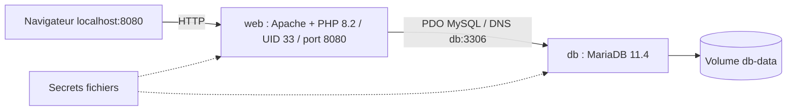

# Projet Docker Ynov - application Articles

Application PHP fournie adaptee a une architecture Apache/PHP + MariaDB, avec stockage persistant, secrets, controles de sante et CI/CD.

## Demarrage rapide

Prerequis : Docker Desktop demarre avec les conteneurs Linux, Docker Compose v2+, Python 3 pour initialiser les secrets et lancer les tests.

Depuis le dossier extrait du ZIP :

```powershell
python scripts/setup.py
docker compose up -d --build --wait
```

Ouvrir **http://localhost:8080**. Si votre installation fournit `docker-compose` au lieu de `docker compose`, remplacer ce prefixe dans les commandes. Les secrets sont generes une seule fois, jamais embarques dans une image ou dans le ZIP. Le premier build necessite Internet et peut prendre plusieurs minutes.

## Architecture



Les deux services partagent le bridge personnalise `app-network`. Seul le Web publie un port, sur la boucle locale de l'hote. La base est accessible par le nom DNS `db` dans le reseau Compose. Front et traitement backend PHP restent dans le meme service Web, conformement au sujet : le decoupage se fait entre application et donnees.

## Configuration

| Variable .env | Valeur par defaut | Role |
|---|---|---|
| WEB_PORT | 8080 | Port local HTTP |
| DB_NAME | articles | Base initialisee |
| DB_USER | articles_app | Compte applicatif limite a cette base |
| DOCKERHUB_USERNAME | ynovlocal | Prefixe des images |
| IMAGE_TAG | latest | Tag construit/utilise |

`scripts/setup.py` copie `.env.example` vers `.env` et genere deux secrets aleatoires dans `secrets/`. Il preserve les fichiers existants. Ces fichiers restent sur l'hote ; Compose les monte en lecture seule dans `/run/secrets/`. Ce mecanisme local ne chiffre pas les fichiers au repos : proteger l'acces au dossier hote. Les fichiers sont lisibles dans le conteneur par www-data. Ne pas partager les secrets.

Les variables MariaDB et le SQL d'initialisation ne sont appliques qu'a un volume vide. Modifier le mot de passe dans un fichier ne change pas celui d'un compte deja cree : effectuer une rotation SQL coordonnee, ou repartir d'un volume vide uniquement si les donnees peuvent etre perdues.

## Verification et demonstration

```powershell
docker compose ps
docker compose logs --tail=50
docker compose exec web sh -c 'for f in *.php; do php -l "$f" || exit 1; done'
python tests/smoke.py
docker compose down
docker compose up -d --wait
python tests/smoke.py --persistence
```

Le test ajoute un article unique, controle les champs obligatoires, la longueur, le CSRF, la methode HTTP et l'echappement XSS. Le second passage retrouve le meme article apres recreation des conteneurs. Il laisse cet article dans la base pour la demonstration. `down` preserve le volume ; **`down -v` efface definitivement la base**.

Verifier le reseau et la connectivite (commandes ci-dessous dans Bash / WSL / Git Bash) :

```bash
docker network ls
docker network inspect ynov-articles_app-network
docker compose exec web getent hosts db
docker compose exec web php -r '$s=fsockopen("db",3306,$errno,$error,5); if (!$s) { exit(1); } echo "TCP OK\n"; fclose($s);'
docker compose exec web id
docker compose exec db sh -c 'ps -eo user,comm | grep mariadbd'
```

MySQL utilise un protocole binaire : `curl http://db:3306` ne teste pas un serveur HTTP. Le test TCP et le healthcheck applicatif PDO sont adaptes. `ping` necessiterait un outil et des capacites supplementaires, inutiles ici.

## Choix de securite et optimisation

- Web execute par www-data, racine en lecture seule, toutes les capacites retirees, interdiction de gagner des privileges ; seuls les repertoires temporaires Apache et PHP sont inscriptibles via tmpfs.
- Apache ecoute sur **8080 dans le conteneur**, choix permettant l'execution non-root sans capacite d'ouverture d'un port privilegie. L'acces demande sur localhost:8080 est conserve.
- MariaDB utilise son entrypoint officiel pour preparer le volume puis abandonne les privileges root pour le serveur. On ne force pas un USER qui casserait la preparation du volume.
- Requetes preparees PDO, encodage utf8mb4, echappement HTML, validation serveur, protection CSRF, cookies HttpOnly/SameSite, messages d'erreur generiques.
- Aucun `chmod 777` : il autoriserait tout utilisateur a modifier les fichiers. Le code appartient a root et est seulement lu par le serveur.
- Build multi-stage : compilation des extensions dans une etape dediee puis copie des modules/configurations dans le runtime. La base PHP officielle contient deja certains outils : le multi-stage ne garantit donc pas a lui seul une reduction importante. Aucune dependance apt additionnelle ni cache apt ajoute.
- `.dockerignore` autorise uniquement les sources utiles ; ni secrets, rapport, historique Git ni archives dans le contexte.
- Les tags de base suivent les correctifs de PHP 8.2 et MariaDB 11.4. Pour une production reproductible, figer les digests apres scan et organiser leur mise a jour.

## Scans et comparaison de taille

Avec Trivy installe :

```powershell
trivy image --severity HIGH,CRITICAL ynovlocal/ynov-articles-web:latest
trivy image --severity HIGH,CRITICAL ynovlocal/ynov-articles-db:latest
docker image inspect php:8.2-apache --format '{{.Size}}'
docker image inspect ynovlocal/ynov-articles-web:latest --format '{{.Size}}'
docker history ynovlocal/ynov-articles-web:latest
```

Tailles en octets non compresses ; comparer sur la meme architecture. Ne pas annoncer de gain sans mesure. Le pipeline bloque les vulnerabilites critiques disposant d'un correctif ; les vulnerabilites sans correctif restent a examiner dans un scan complet. Reconstruire avec `--pull` pour recuperer les correctifs disponibles.

## CI/CD et Docker Hub

Le workflow `.github/workflows/docker.yml` se declenche sur PR, push main/master et manuellement. Il construit les deux images, valide la syntaxe PHP, demarre la stack, teste HTTP et persistance, puis scanne les deux images. Sur push ou lancement manuel, il publie uniquement apres succes, avec `latest` et le SHA complet du commit. Les PR ne recoivent pas les identifiants de publication.

Creer deux depots publics Docker Hub : `ynov-articles-web` et `ynov-articles-db`. Ajouter dans les secrets GitHub Actions `DOCKERHUB_USERNAME` et `DOCKERHUB_TOKEN` (jeton Docker Hub avec droit d'ecriture). Le ZIP ne contient aucun identifiant personnel. La publication distante et la creation du depot GitHub necessitent votre compte.

Publication manuelle apres avoir renseigne votre pseudo dans `.env` :

```powershell
docker login
docker compose build --pull
docker compose push
```

Initialiser le depot local depuis ce dossier :

```powershell
git init
git add .
git commit -m "feat: containerize PHP articles application"
git branch -M main
# Ajouter ensuite votre URL : git remote add origin URL_DU_DEPOT
git push -u origin main
```

## Soutenance (5 minutes)

1. Presenter le schema et le role de chaque service, du DNS et du volume.
2. Montrer `docker compose ps`, ouvrir le site, publier un article.
3. Executer `down`, puis `up -d --wait`, montrer que l'article reste present.
4. Montrer l'utilisateur Web, les secrets, le Dockerfile et les protections Compose.
5. Presenter le workflow et distinguer les verifications locales des executions distantes.

Le rapport technique et les preuves de validation disponibles se trouvent dans `docs/`.

## References officielles

- [Image PHP](https://hub.docker.com/_/php)
- [Image MariaDB](https://hub.docker.com/_/mariadb)
- [Secrets Compose](https://docs.docker.com/compose/how-tos/use-secrets/)
- [Docker Compose](https://docs.docker.com/compose/)
